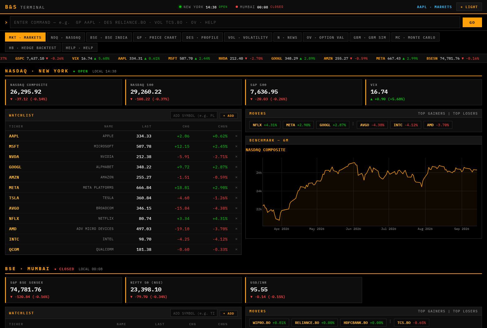
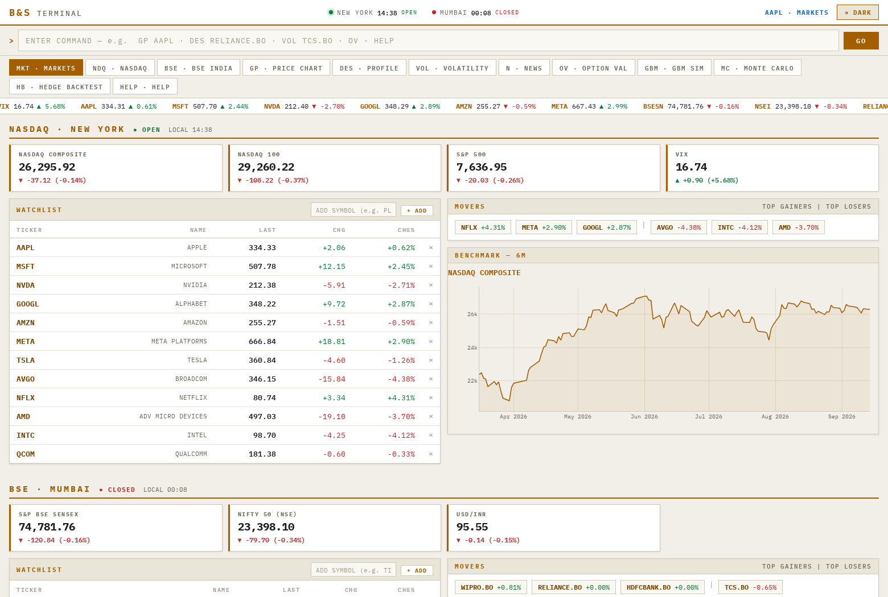
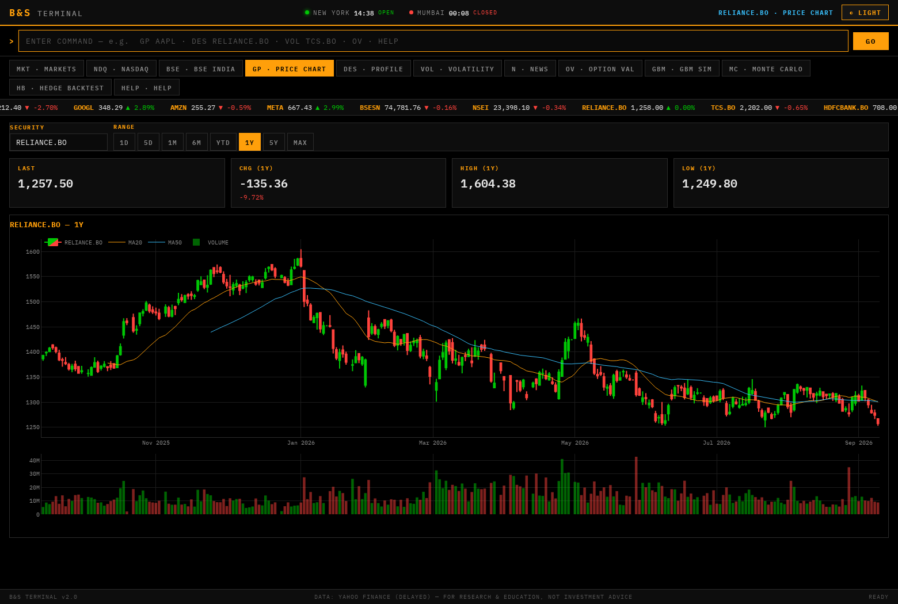
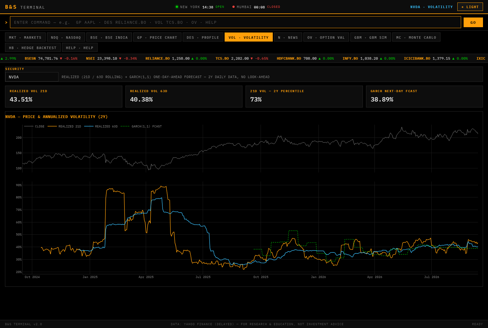
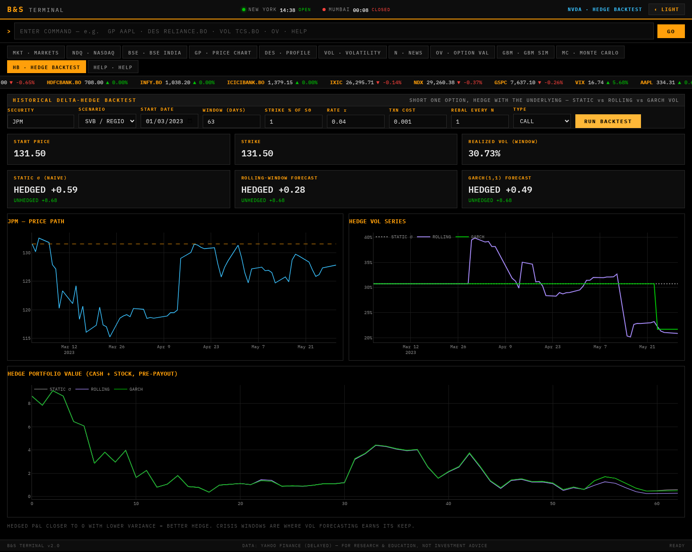
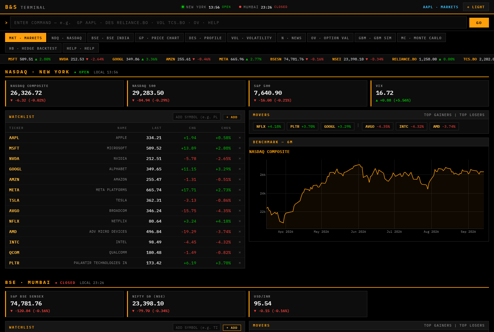

# B&S Terminal

A Bloomberg-style market and derivatives terminal covering **NASDAQ (US)** and
**BSE (India)**, built on a FastAPI backend with a dependency-free HTML/CSS/JS
frontend. Command-driven navigation, live market data, and a quantitative
toolkit: Black-Scholes valuation, Monte Carlo pricing, GBM simulation, and a
historical delta-hedge backtester with GARCH volatility forecasting.

> Market data comes from Yahoo Finance (delayed). For research and education
> only — not investment advice.

---

## Screenshots

### Market monitor — NASDAQ & BSE sections



### Light theme



### Price chart — candles, volume, moving averages



### Volatility monitor — realized vol + GARCH(1,1) forecast



### Historical delta-hedge backtest



### Customizable watchlists



---

## Features

**Markets**

- **MKT** — global monitor with two dedicated sections: NASDAQ (Composite,
  NASDAQ-100, S&P 500, VIX + mega-cap watchlist) and BSE (SENSEX, NIFTY 50,
  USD/INR + large-cap `.BO` watchlist), each with live status, movers, and a
  benchmark chart.
- **Customizable watchlists** — add or remove symbols per section straight
  from the UI (`+ ADD` in the watchlist header, `✕` on any row). Symbols are
  validated against Yahoo before being added; bare symbols in the BSE section
  get the `.BO` suffix automatically (`TITAN` → `TITAN.BO`). Changes persist
  server-side in `watchlists.json`, and the movers, relative-performance
  chart, and ticker tape follow your custom lists.
- **NDQ / BSE** — focused views per exchange with relative-performance charts
  and headlines.
- **GP** — candlestick price charts with volume and MA20/MA50, ranges from
  intraday (1D) to MAX.
- **DES** — company profile: valuation multiples, margins, 52-week range,
  business description, headlines.
- **VOL** — realized volatility (21d / 63d rolling) plus a rolling
  GARCH(1,1) one-day-ahead forecast, fit with no look-ahead.
- **N** — security and broad-market news.

**Quant lab**

- **OV** — Black-Scholes price and full greeks, with price/delta/gamma/vega
  curves across spot.
- **GBM** — geometric Brownian motion path simulator.
- **MC** — risk-neutral Monte Carlo pricer benchmarked against the closed form.
- **HB** — historical delta-hedge backtest: short an option on a real price
  window (2008 crisis, COVID crash, SVB 2023, …) and compare hedging under a
  static vol assumption vs rolling-window vs GARCH(1,1) forecasts, including
  transaction costs and rebalancing frequency.

**Terminal UX**

- Bloomberg-style command line: `GP RELIANCE.BO`, `DES NVDA`, `VOL TCS.BO`,
  `HB`, or just a bare ticker. Press `/` to focus the command line.
- Dark and light themes (toggle in the top bar, persisted across sessions).
- Scrolling ticker tape, New York + Mumbai market clocks with open/closed
  status, clickable watchlists.

---

## Getting started

Requires Python 3.11+.

```bash
python -m venv .venv
source .venv/bin/activate
pip install -r requirements.txt

uvicorn app:app --port 8000
```

Open <http://localhost:8000>. Interactive API docs are at
<http://localhost:8000/docs>.

---

## Commands

| Command         | Function                                              |
| --------------- | ----------------------------------------------------- |
| `MKT`           | Global markets — NASDAQ + BSE sections                |
| `NDQ`           | NASDAQ section                                        |
| `BSE`           | BSE India section                                     |
| `GP <ticker>`   | Price chart (candles, volume, moving averages)        |
| `DES <ticker>`  | Security profile                                      |
| `VOL <ticker>`  | Volatility monitor (realized + GARCH forecast)        |
| `N <ticker>`    | News headlines                                        |
| `OV`            | Black-Scholes option valuation                        |
| `GBM`           | GBM path simulator                                    |
| `MC`            | Monte Carlo option pricer                             |
| `HB`            | Historical delta-hedge backtest                       |
| `HELP`          | Command reference                                     |

BSE symbols use Yahoo's `.BO` suffix (`RELIANCE.BO`, `TCS.BO`,
`HDFCBANK.BO`, …). US symbols are plain (`AAPL`, `NVDA`). Indices:
`^IXIC`, `^BSESN`, `^NSEI`, `^GSPC`.

> Note: Yahoo's BSE feed only serves live quotes; historical charts for `.BO`
> symbols transparently fall back to the company's NSE listing (`.NS`), which
> is dual-listed at virtually identical prices. SENSEX (`^BSESN`) history
> works natively.

---

## Architecture

```
app.py           FastAPI app — JSON API + serves the frontend
quant.py         Pure-numpy quant engines (Black-Scholes, GBM, Monte Carlo,
                 variable-sigma delta-hedge engine, rolling & GARCH vol)
market_data.py   yfinance data layer with in-process TTL caching,
                 NASDAQ + BSE universes
static/
  index.html     Terminal shell
  css/terminal.css   Dark/light themes via CSS variables
  js/app.js      SPA router, command parser, Plotly rendering
```

The backend is stateless; all market data is cached in-process with short
TTLs (quotes 90 s, history 3 min, profiles 1 h). The quant module has no
framework dependencies and is directly unit-testable.

### Key API endpoints

| Endpoint         | Description                                    |
| ---------------- | ---------------------------------------------- |
| `/api/markets`   | NASDAQ + BSE indices, watchlists, market state |
| `/api/watchlist/add`, `/api/watchlist/remove` | Customize section watchlists (POST) |
| `/api/history`   | OHLCV for any Yahoo symbol, `range=1D…MAX`     |
| `/api/vol`       | Realized + GARCH volatility series             |
| `/api/ov`        | Black-Scholes greeks + curves                  |
| `/api/mc`        | Monte Carlo pricing vs closed form             |
| `/api/backtest`  | Delta-hedge backtest on historical windows     |

---

## Notes on the hedging methodology

The backtester shorts one European option at the model price, then
delta-hedges along the realized path. Every vol estimator is strictly
causal: at step *t* it only sees prices up to *t* (rolling windows) or is
refit on a trailing window (GARCH). Hedged P&L near zero with low variance
indicates a good hedge; the gap between the static-vol and forecast-driven
runs shows the value of volatility forecasting, especially in crisis
windows where realized vol moves fast.
